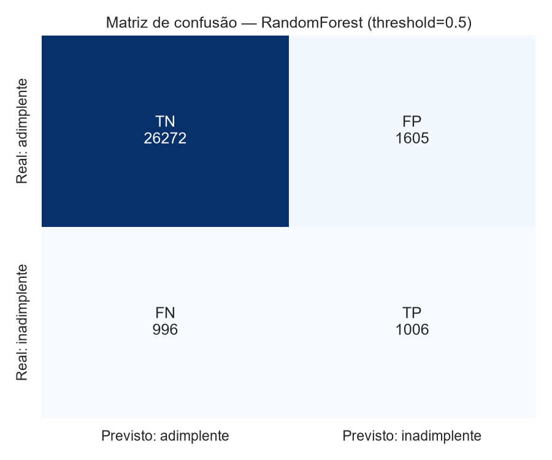
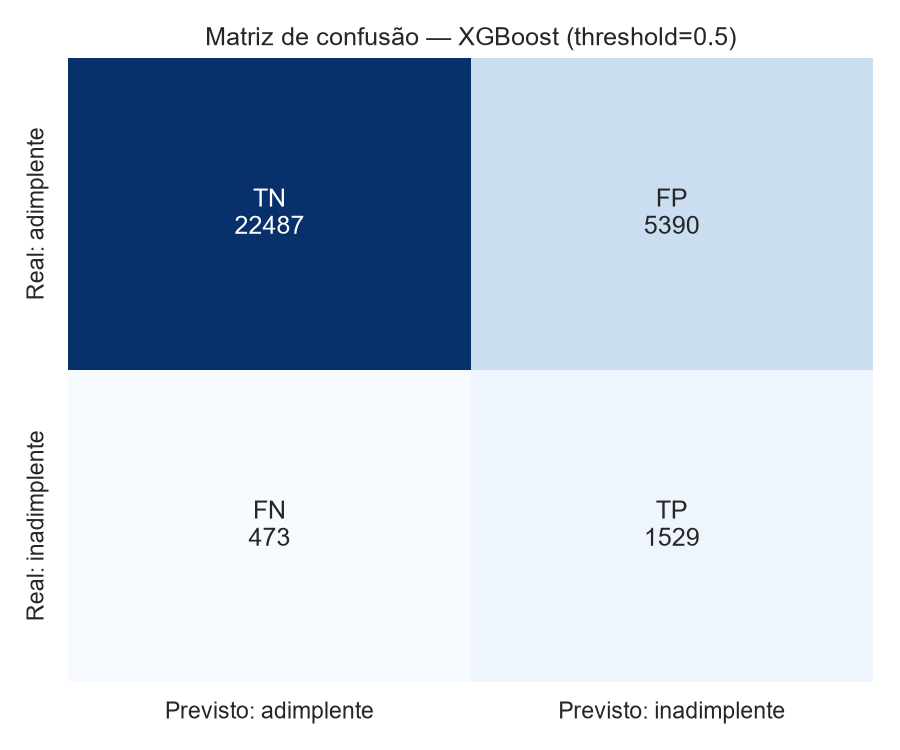
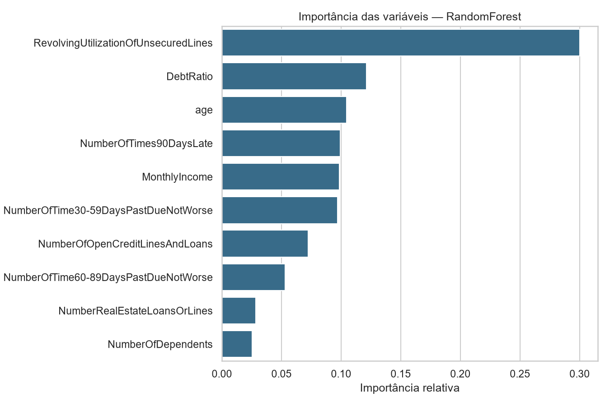
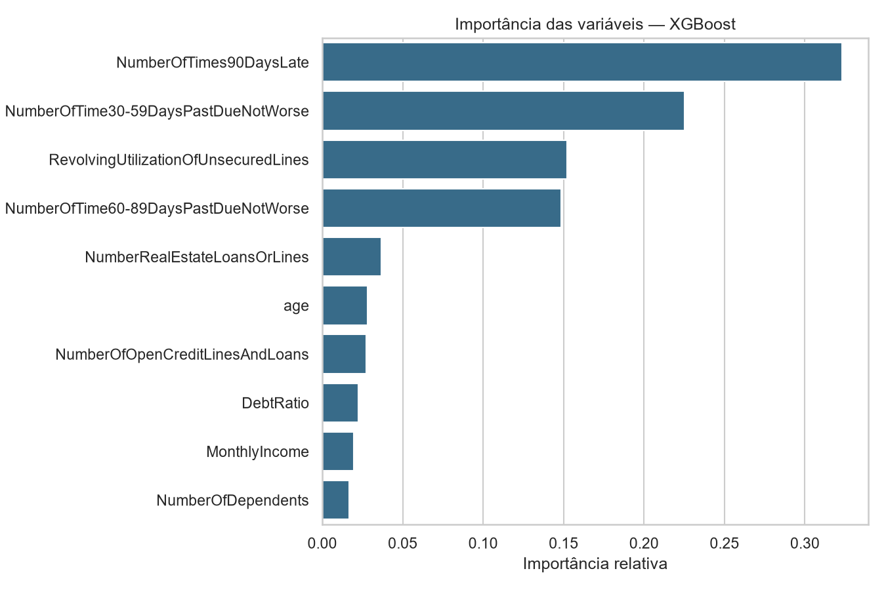

# Modelo de Risco de Inadimplência de Crédito

Pipeline de classificação binária para estimar a probabilidade de um cliente
apresentar inadimplência grave em até dois anos (`SeriousDlqin2yrs`), usando o
dataset público **Give Me Some Credit** (150.000 registros).

## Objetivo

Apoiar a decisão de concessão de crédito priorizando clientes com maior risco.
O projeto compara um baseline interpretável (Random Forest) com um modelo
avançado baseado em gradient boosting (XGBoost) e disponibiliza o melhor modelo
treinado como artefato reutilizável.

## Dados

- Arquivo: `data/cs-training.csv` (11 colunas: 1 alvo + 10 variáveis explicativas).
- Após remoção de 609 duplicatas: **149.391 registros**, sendo **6,70%** de
  inadimplentes (10.009 casos) — dataset desbalanceado.
- `MonthlyIncome` ausente em **19,56%** e `NumberOfDependents` em **2,56%**.
- Códigos sentinela `96/98` nas colunas de atraso (225 registros em cada) e 1
  registro com `age = 0` são tratados como valores ausentes.

## Estrutura do projeto

```
├── data/cs-training.csv          # dataset de treino
├── models/credit_model.pkl       # melhor modelo (Pipeline com limpeza + imputação)
├── reports/
│   ├── data_summary.json         # auditoria dos dados
│   ├── metrics.json              # métricas completas por modelo
│   ├── model_comparison.csv      # comparativo baseline x avançado
│   ├── feature_importance.csv    # ranking de importância das variáveis
│   └── figures/                  # matrizes de confusão e importâncias
├── src/
│   ├── preprocessing.py          # CreditDataCleaner (sentinela/idade inválida)
│   └── pipeline.py               # treino, avaliação e salvamento
├── logs.md                       # registro das etapas executadas
└── requirements.txt
```

## Como executar

Pré-requisito: Python 3.15 com ambiente virtual local.

```bash
source .venv/Scripts/activate      # Git Bash
# .venv\Scripts\activate           # PowerShell / cmd
pip install -r requirements.txt
python -m src.pipeline
```

O comando executa todo o pipeline (~70 s em 4 núcleos) e grava modelo,
métricas e figuras nos diretórios `models/` e `reports/`.

## Pipeline

1. **Limpeza:** remoção da coluna de índice e de duplicatas exatas.
2. **Pré-processamento:** sentinelas `96/98` e `age = 0` viram `NaN`;
   imputação pela **mediana** ajustada apenas no treino (dentro do `Pipeline`).
3. **Divisão:** holdout estratificado 80/20 com `random_state=42`
   (119.512 treino / 29.879 teste).
4. **Modelos:** `RandomForestClassifier` (baseline) e `XGBClassifier`
   (avançado), ambos com `random_state=42` e tratamento de desbalanceamento
   (`class_weight="balanced_subsample"` e `scale_pos_weight`).
5. **Avaliação:** ROC-AUC, PR-AUC, precisão, revocação, F1, acurácia e matriz
   de confusão (threshold de 0,5), além de importância das variáveis.
6. **Artefato:** o modelo com maior ROC-AUC no teste é salvo em
   `models/credit_model.pkl` via `joblib`.

## Resultados (conjunto de teste)

| Modelo | ROC-AUC | PR-AUC | Precisão | Revocação | F1 | Acurácia |
|---|---|---|---|---|---|---|
| Random Forest (baseline) | 0,8554 | 0,3809 | 0,3853 | 0,5025 | 0,4362 | 0,9129 |
| **XGBoost (avançado)** | **0,8614** | **0,3959** | 0,2210 | 0,7637 | 0,3428 | 0,8038 |

O XGBoost foi selecionado (melhor ROC-AUC e PR-AUC). Com `scale_pos_weight`,
ele prioriza revocação no threshold 0,5 (detecta ~76% dos inadimplentes, com
muitos falsos positivos); o Random Forest é mais conservador e atinge maior
precisão. O threshold deve ser ajustado ao custo de negócio antes do uso.

Variáveis mais relevantes:

- **Random Forest:** utilização do crédito rotativo (0,300), `DebtRatio` (0,121),
  idade (0,104).
- **XGBoost:** atrasos graves (0,323), atrasos de 30–59 dias (0,225),
  utilização do rotativo (0,152).

### Visualizações

| Matriz de confusão (RF) | Matriz de confusão (XGB) |
|---|---|
|  |  |

| Importância (RF) | Importância (XGB) |
|---|---|
|  |  |

## Usando o modelo salvo

O artefato é um `Pipeline` completo (limpeza → imputação → XGBoost), portanto
aceita dados brutos com valores ausentes e sentinelas:

```python
import joblib
import pandas as pd

from src.pipeline import FEATURES

model = joblib.load("models/credit_model.pkl")
new_data = pd.read_csv("data/cs-training.csv").head(5)
probabilities = model.predict_proba(new_data[FEATURES])[:, 1]
print(probabilities)
```

> O pickle referencia `src.preprocessing.CreditDataCleaner`; execute o código a
> partir da raiz do projeto (ou inclua a raiz no `PYTHONPATH`).

## Limitações

- O conjunto de teste foi usado para comparar os modelos (sem validação
  separada), o que pode superestimar levemente a performance de generalização.
- Probabilidades não são calibradas; o threshold fixo de 0,5 não reflete
  necessariamente o custo de crédito.
- Não há monitoramento de *data drift* nem validação temporal.
